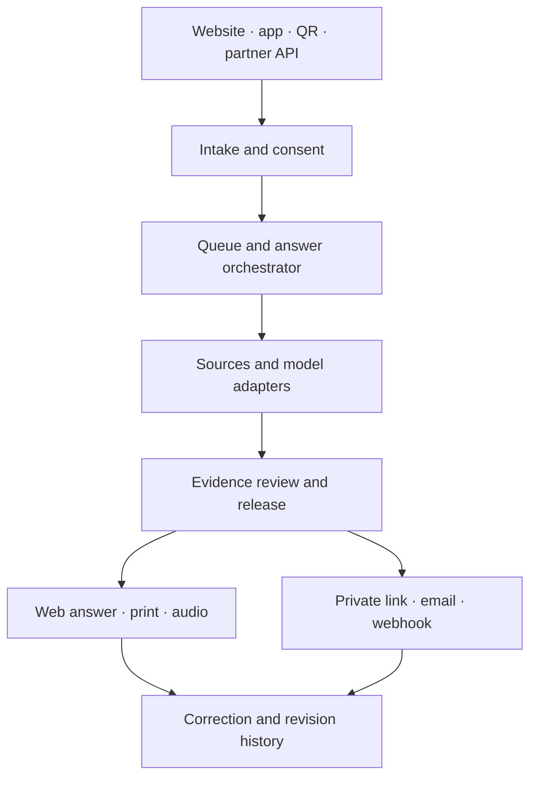

# Send a Question. Bring Your Judgment.
## Croizier.AI and the Save Our AI Society

**Public promise:** A little more peace of mind about what you know, what you still need to check, and what you can do next.

**Public invitation:** Bring a question you can share safely. Read the answer. Check a source. Tell us what we missed.

## The story

I’m Steve the IT guy. I spent years answering calls from people who had already tried everything except the one thing that would work. What they needed from me was a clear next step and some way to tell whether it worked.

I was driving down Tejon Pass toward San Diego when I started thinking about what happened after those calls. What if the answer could travel with you? A note you could open when you got home. Something you could show a colleague. Something that still made sense in the morning.

Now picture a woman waiting for the ferry. There’s a poster with a bottle on it and a square she can scan. She has a question about a message she received. She opens Croizier.AI, leaves out the names, and submits the question. A few moments later, she has three things she can use. An explanation, a source she can open, and a detail she still needs to verify. She checks the source. It doesn’t quite say what the answer says. So she flags it.

The flag matters. The next person should get the corrected explanation, and the first person should be able to see what changed. That’s the part I want the Save Our AI Society to work on with us.

I’ve helped rally people around boats and doctors. The name still gets a grin. This time, I’m asking people to bring their own knowledge to the conversation. A librarian can spot a weak citation. A mechanic can see where a procedure skips a step. A translator can tell you when a perfectly grammatical sentence gives entirely the wrong impression.

The bottle is a picture of a question sent out into the world. The answer comes back with an invitation to open it up and look inside.

## Architecture | one question, many routes

The following describes the proposed system. The campaign launches with the functions that have passed the pilot.

| Channel | What happens | Delivery |
|---|---|---|
| Website | A visitor types a question, pastes an AI answer for review, or opens a sample. They see what is sent before submission. | Browser answer with sources, limits, revision date and next step. Printable answer card. |
| QR poster or printed card | The code opens a readable HTTPS landing URL with a campaign identifier. Opening the page is the event. The visitor chooses whether to submit. Print the same URL beside the QR. | Same browser experience, with a low-bandwidth text option. |
| App | A mobile client uses the same intake service. It may open a saved answer if the visitor has access. | In-app answer and a generic opt-in completion notification. |
| AI or partner integration | An authenticated client submits a question or candidate answer and polls a job ID or subscribes to a signed completion event. | Structured response with evidence links and review state. |
| Help desk | A staff member links an internal ticket to a restricted submission and reviews the customer-facing summary. | Private answer link and reviewed ticket update. Staff retain closure responsibility. |

**Processing path.** Validate and rate-limit submissions. Capture locale, consent and visibility. Queue with an idempotency key. Retrieve evidence from authorized sources. Route to appropriate model adapters under a per-job cost and time budget. Treat retrieved material and model output as untrusted content. Verify claim-to-source links and escalate weak, conflicting or high-impact cases. On timeout, keep the job observable and allow safe retry. Signed webhooks carry IDs and status, with duplicate delivery handled by the receiver.

**Tertiary truth, as a review method.** First, record the proposed answer. Second, check its material claims against independently identifiable evidence. Third, resolve conflicts through an accountable review or show the uncertainty and the next check. Several models agreeing is still one signal. For a demo, show a fictional library schedule with a regular-hours page and a dated holiday closure notice. Readers should see why the dated notice changes the answer.

**Answer record.** Keep separate request, candidate and published-answer IDs. The published record carries the conclusion, individual claims, sources with dates, unresolved points, review state, version and visibility. Corrections create a revision. Limit internal records to authorized staff and keep user text out of analytics. Keep public examples and restricted support workflows in separate access boundaries. Make public sharing explicit. Allow revocation of private links and use short retention for unneeded inputs. Maintain a plain-text route and translate the interface and answer independently. Start with English and have local partners review translations and examples before expanding.

## Creative direction

The bottle and rolled note connect the brand’s existing message-in-a-bottle imagery to a visible act of inquiry. Use ink blue, sea green, warm ivory and amber. Use ferry ambience, rain on glass, paper unfolding and a three-note piano-like theme. The visual progression moves from a solitary question in the dark to several people examining the same answer in daylight. Use local settings and examples in each edition. Invite local librarians, teachers, repair technicians and artists to lead their own events, with permission and credit for contributed work.

Treat the campaign as openly attributed public advocacy. Put the Croizier.AI name on every piece and make the demonstration available for anyone to challenge. The recurring call to action is “Try a sample question.” Every ad drives to the same demo with a channel-specific campaign code. Publish a plain-language correction when an example changes.

## Copy and production

**Poster**  
SEND A QUESTION.  
BRING YOUR JUDGMENT.  
Croizier.AI

Add an accessible QR caption and visible URL in the print layout once the campaign address is confirmed. Test the printed code on several phones in the actual display conditions.

**Landing page**  
Headline: Send a question. Bring your judgment.  
Deck: See what the evidence supports, where the answer is uncertain, and what you can check next.  
Primary button: Try a sample question  
Secondary button: See how an answer is checked  
Submission hint: Leave out names, account details, and other private information.

**30-second film script**  
0–6 s | Rain and a ferry horn. Steve, voice-over: “On my way south, I kept thinking about the moment after a help desk call.”  
6–12 s | A visitor opens the demo from a poster. “You’ve got an answer. Can you tell where it came from?”  
12–20 s | Fictional library example on screen. “Here’s the source. Here’s the part we still need to check.”  
20–26 s | Visitor flags a detail and a correction appears. “And here’s what happened when somebody checked it.”  
26–30 s | Bottle, wordmark and URL. “Croizier.AI. Send a question. Bring your judgment.”  
Use open captions, high contrast and a descriptive transcript. The included teaser is a separate captioned cut with the original score.

**15-second radio or podcast read**  
“You have a question. Croizier.AI shows you an answer, where it came from, and what still needs checking. Try a sample question at Croizier dot A I. Send a question. Bring your judgment.”

**Social carousel**  
1. Can you trace an AI answer back to its source?  
2. Try the sample question.  
3. Open the source. Check the date.  
4. Spot something wrong? Flag it.  
5. Send a question. Bring your judgment. Croizier.AI.

**Partner invitation**  
“Host a Question Night with the Save Our AI Society. Bring one public question, one source worth checking, and one thing you’d change about the answer. We’ll provide the demo, poster and a printable answer card.”

**Question Night format, 45 minutes**  
Five minutes for host introduction. Ten for the fictional example. Fifteen for groups to verify a source or challenge a claim. Ten to compare results. Five to file one public correction or submit an anonymized sample. Provide paper copies so participants can take part with no device.

**Visual alt text**  
A sea-green bottle holding a rolled paper note sits at a rain-wet ferry terminal at dawn. The poster reads “Send a question. Bring your judgment. Croizier.AI.”

## Rollout and measurement

| Phase | Public activity | Evidence to review |
|---|---|---|
| Week 1 | Invite a small group to a fictional sample-only pilot. | Can users identify a claim, find its source, and flag an error? Check accessibility and small-screen readability. |
| Week 2 | Release poster, scored teaser and a landing page with the sample. Place QR materials at cooperating venues. | Measure landing-to-demo completion, source opens and valid feedback without logging question text in analytics. |
| Week 3 | Host Question Night and publish a correction story. | Measure the share of participants who can name a next step and the time to review a reported error. |
| Week 4 | Release revised copy and invite additional local partners. | Check results by language and channel where sample sizes allow. Review unanswered cases and sign off before enabling public submissions. |

Ask one optional exit question: “Do you know what to check next?” Measure progress on that question and verified source use alongside reach. Pilot the claimed features before promoting them. The QR destination, translations and broadcaster voice-over are production work after the campaign address and launch scope are confirmed.
